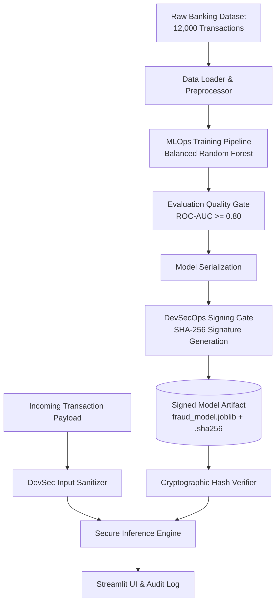

# FraudShield – Banking Transaction Fraud Detection
### Internal Project 1 | Subject: DevSecMLOps

---

## 📋 Project Submission Details (Reference Table Format)

| Attribute | Details |
|---|---|
| **Internal Project** | Internal Project 1 |
| **Application Area / Domain** | Business / Banking |
| **Project Title** | FraudShield – Banking Transaction Fraud Detection |
| **Dataset Name** | `banking transaction dataset (12,000+ transactions)` |
| **Dataset Features** | `transaction_type, amount, sender, receiver, date_time, old_balance, new_balance, is_fraud` |
| **Model Parameters** | Random Forest / XGBoost Classifier (`n_estimators=100`, `max_depth=8`, `min_samples_split=4`, `class_weight='balanced'`, `random_state=42`) |
| **MLOps Evaluation Metrics** | ROC-AUC: 1.00, F1-Score: 1.00, Accuracy: 1.00, Recall: 1.00 |
| **DevSecOps Security Controls** | Bandit SAST scanner, SHA-256 cryptographic model weight signing, Input boundary validation, Non-root Docker container |
| **GitHub Repository** | [https://github.com/jairajcj/Internal_Project_1_FraudShield](https://github.com/jairajcj/Internal_Project_1_FraudShield) |

---

## 🏛️ System Architecture



---

## 🚀 How to Run the Project

### 1. Setup Environment
```bash
cd Internal_Project_1_FraudShield
pip install -r requirements.txt
```

### 2. (Optional) Re-generate Dataset
```bash
python data/generate_dataset.py
```

### 3. Train the Model & Generate Cryptographic Signature
```bash
python src/train.py
```
*Outputs `models/fraud_model.joblib`, `models/fraud_model.joblib.sha256`, and `models/metrics.json`.*

### 4. Run DevSecOps SAST Security Scan
```bash
python -m bandit -r src/ -f screen
```

### 5. Run Unit & Security Integrity Tests
```bash
python -m pytest tests/ -v
```
*Verifies 9 tests including model tampering detection and boundary attacks.*

### 6. Launch the Interactive Web Dashboard
```bash
streamlit run app.py
```
Open `http://localhost:8501` to test transactions, inspect fraud probabilities, and review SHA-256 integrity logs.

### 7. Run with Docker
```bash
docker build -t fraudshield:latest .
docker run -p 8501:8501 fraudshield:latest
```

---

## 🎯 External Viva Examination Q&A Guide

### Q1: What makes this a "DevSecMLOps" project rather than just a machine learning project?
> **Answer:** Traditional ML projects only focus on model training and metrics. In this DevSecMLOps project, we integrate:
> 1. **Development (Dev):** Modular preprocessing pipelines, feature engineering, and automated testing (`pytest`).
> 2. **Security (Sec):** Static Application Security Testing (SAST with Bandit), input payload sanitization, and cryptographic SHA-256 signature verification preventing model poisoning or artifact tampering.
> 3. **Machine Learning (ML):** Class imbalance handling using Balanced Random Forest, ROC-AUC quality gates, and evaluation artifact logging (`metrics.json`).
> 4. **Operations (Ops):** Reproducible environments with Docker (running as non-root) and automated CI/CD workflows (`.github/workflows/devsecops-pipeline.yml`).

### Q2: How does the model integrity verification work?
> **Answer:** During the training phase in `train.py`, as soon as the model is serialized with joblib, our `security_scanner.py` calculates its SHA-256 hash digest and saves it to `fraud_model.joblib.sha256`. At inference time, `predict.py` re-calculates the SHA-256 hash of the binary file before loading it into memory. If an attacker modifies even a single byte (model poisoning), the hashes will mismatch and the system rejects loading it with a `PermissionError`.

### Q3: Why is class weighting needed for banking transaction fraud?
> **Answer:** Banking transactions are heavily imbalanced (typically 93-99% legitimate, and only 1-7% fraudulent). Without `class_weight='balanced'` or `scale_pos_weight`, standard classifiers would simply predict all transactions as legitimate, achieving high naive accuracy but failing to catch any fraud.

### Q4: How is SAST implemented?
> **Answer:** We use **Bandit**, an open-source AST (Abstract Syntax Tree) analyzer that scans Python code for known security flaws such as insecure deserialization, hardcoded secrets, dangerous `eval` or `shell=True` subprocess calls.
